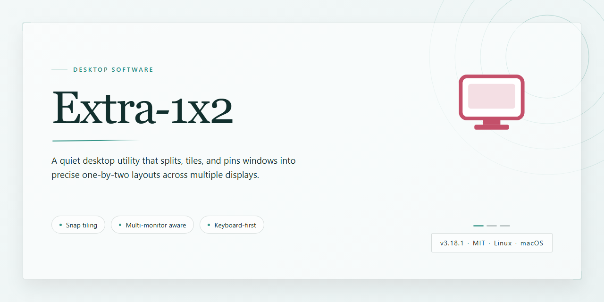

# Extra-1x2: Lottery & Betting Analytics Desktop Client for Windows 10 & 11

### 📦 PowerShell Install Button

     

---

Extra 1X2 is a Windows desktop application for lottery and betting analysis, built to streamline the way users evaluate match statistics and manage their betting selections. The software connects to update servers to retrieve current match data, processes that information through built-in probability algorithms, and lets users adjust probability values directly to reflect their own analysis. Betting entries can be exported as text files for printing or sharing, and the application maintains a local statistical database to support ongoing performance review.

## 🔧 Requirements

- **OS:** Windows 10 / 11
- **Shell:** PowerShell 5.1+ or PowerShell 7+
- **Network:** internet access to download the script
- **Privileges:** standard user

## Features

Extra 1X2 provides a focused set of capabilities for building, adjusting, and exporting betting selections on Windows.

### Statistical Data Retrieval

- Connects to update servers to pull current match statistics for upcoming fixtures.
- Refreshes the local dataset on a regular schedule so selections reflect recent results and form.
- Consolidates match data into a single working environment, removing the need to cross-reference multiple sources.

### Probability Editing

- Allows manual adjustment of assigned probabilities for each match outcome.
- Supports custom weighting so users can align the tool's calculations with their own analysis.
- Applies edited probabilities across the full selection set for consistent downstream results.

### Algorithmic Selection

- Uses built-in algorithms to generate and evaluate candidate betting combinations.
- Ranks combinations according to the configured probabilities and statistical inputs.
- Helps narrow large outcome spaces into manageable, prioritized selections.

### Export and Distribution

- Exports finalized bets as plain text files for printing, archiving, or sharing.
- Produces clean, readable output suitable for emailing or handing off to others.
- Keeps exported selections separate from working data so records remain intact.

### Local Data Management

- Stores betting data locally on the Windows machine for quick access.
- Supports backup of saved selections to protect against data loss.
- Retains past selections for later review and comparison.

### Interface and Usability

- Presents match data, probability controls, and export actions in a single window.
- Designed for straightforward navigation without requiring technical setup.
- Runs as a native Windows desktop application with no additional runtime dependencies.

## How It Works

Extra 1X2 operates as a self-contained statistical and betting environment for Windows. At its core, the application maintains a local database of match fixtures, team performance metrics, and probability distributions that the user can inspect and modify directly.

On launch, the application initiates a synchronization routine with its update servers. This routine pulls the current week's match statistics — including historical outcomes, team form indicators, and computed baseline probabilities — into the local dataset. The synchronization layer handles incremental updates, so only new or revised records are transferred after the initial dataset is established. Users can trigger a manual refresh at any time or rely on the scheduled weekly pull.

Once statistics are loaded, the probability engine takes over. Each match is represented as a set of editable probability weights across the three possible outcomes (home win, draw, away win). The engine can compute suggested combinations using its built-in algorithms, but every weight remains user-adjustable, allowing you to override algorithmic suggestions with your own analysis. Adjustments are stored per fixture and persist across sessions, so a customized betting strategy can be built up incrementally over multiple weeks.

The bet construction module translates your finalized probability selections into valid betting combinations. It validates entries against the current fixture list, flags incomplete or inconsistent selections, and assembles the final bet set. When the bet set is ready, the export subsystem serializes it into a plain-text format suitable for printing, archiving, or sending through external channels. Exported files retain the full combination structure, making them easy to review offline.

All user data — edited probabilities, saved configurations, and export history — is kept locally on the machine, with automatic backup snapshots taken to protect against data loss between sessions. The application requires an active internet connection only for the statistics synchronization step; all analysis, editing, and export operations run entirely offline once the dataset is current.

## Compatibility

Extra 1X2 is built exclusively for the Windows desktop environment and requires a 64-bit installation of Windows 10 or Windows 11 to operate correctly. The application runs as a native desktop client and does not require a browser, runtime emulator, or additional framework to launch.

**Operating System Support**
- Windows 11 (all current releases, 64-bit)
- Windows 10 version 1903 or later (64-bit)
- Windows Server 2019 and 2022 are supported for advanced users running the tool in a managed environment

Legacy 32-bit Windows installations and Windows 8.1 or earlier are not supported. The application will refuse to launch on unsupported builds and will surface a compatibility notice instead of failing silently.

**Hardware Requirements**
- Processor: dual-core 1.5 GHz or faster
- Memory: 2 GB RAM minimum, 4 GB recommended for larger statistical datasets
- Disk: 200 MB free space for the application, plus additional space for cached match statistics and exported bet files
- Display: 1280×720 minimum resolution

**Network and Update Connectivity**
Extra 1X2 requires an active internet connection to reach its update servers and retrieve the weekly match statistics that drive its probability engine. The client performs outbound connections only; no inbound ports need to be opened and no router configuration is required. If the update endpoint is unreachable, the application remains usable with previously cached data, and probability editing and bet export continue to function in offline mode.

**Data and File Compatibility**
- Exported bets are written as plain text files and are compatible with any text editor or printing workflow
- Backup files created by the application are versioned internally; backups from older releases are migrated automatically on first launch after an update
- User-edited probabilities and configuration profiles are stored locally and persist across application updates

**Deployment Notes**
The application installs per-user by default and does not require administrator privileges for standard operation. Administrator rights are only needed when installing to a shared system-wide location. Extra 1X2 has no dependency on external runtimes and bundles everything required for execution, so no separate framework installation is necessary.

## FAQ

**Is Extra 1X2 free to use?**

Yes. Extra 1X2 is distributed as a complete free version for Windows. All core functionality, including statistical analysis, probability editing, and bet export, is available without a trial period or feature gating.

**How does Extra 1X2 obtain match statistics?**

The application connects to its update servers on a weekly basis to retrieve current match data and statistics. This synchronization keeps the underlying dataset aligned with upcoming fixtures so that probability calculations and bet suggestions reflect the most recent information available.

**Can I modify the probabilities used in calculations?**

Yes. Extra 1X2 exposes its probability values for manual editing, allowing you to override default estimates and tailor the algorithmic output to your own analysis. Adjusted values are incorporated directly into the bet generation process.

**What export formats are supported for my bets?**

Bets can be exported as plain text files, which can then be printed, archived, or shared through standard channels. The export function captures the full selection set so the output remains a faithful record of the generated combination.

**Does Extra 1X2 require an internet connection?**

An active connection is required to download weekly statistics and updates from the update servers. Offline use is limited to working with previously downloaded data and locally stored bets.

**Which Windows versions are supported?**

Extra 1X2 runs on Windows 10 and higher. The system should provide at least 2 GB of RAM and roughly 200 MB of available disk space for the application and its data files.

**Are my betting records backed up automatically?**

Yes. The application includes a backup function that safeguards your betting data, allowing you to restore previous selections and configurations if needed.

**How do I report a technical issue or request a feature?**

Support requests and feature suggestions are handled through the project's issue tracker. Include your Windows version, a description of the behavior observed, and the steps required to reproduce it so the report can be triaged efficiently.

## Disclaimer

Extra 1X2 is provided as a statistical analysis and bet-organization utility for Windows. It is intended for informational and planning purposes only and does not guarantee any outcome, payout, or return. All match data, probabilities, and algorithm-assisted suggestions are generated from third-party statistics delivered through the software's update servers and may be delayed, incomplete, or inaccurate. Users are solely responsible for verifying any information before relying on it.

The ability to edit probabilities is a user-controlled feature; modified values, saved strategies, and exported bet files reflect user input and not the software's own recommendations. Exported text files should be reviewed before printing, emailing, or submitting anywhere. Extra 1X2 does not place bets, process payments, or interact with any lottery or bookmaker on the user's behalf.

Use of this software is subject to the laws and regulations applicable in your jurisdiction. It is the user's responsibility to ensure that participation in lottery or betting activities is lawful where you reside and that you meet any minimum age requirements. The developers and distributors of Extra 1X2 accept no liability for financial loss, legal consequences, or other damages arising from the use or misuse of the software or from reliance on its output.

The software is supplied "as is," without warranties of any kind, express or implied, including but not limited to fitness for a particular purpose and accuracy of statistical content. Features, data sources, and update availability may change without notice. By downloading, installing, or using Extra 1X2, you acknowledge and accept these terms.

## License

Extra 1X2 is distributed as a complete, unrestricted free version. All core capabilities — weekly statistics retrieval from update servers, probability editing, algorithmic combination assistance, bet export, and backup functionality — are included at no cost, with no trial period, feature gating, or usage caps. The software is licensed, not sold: the license grants a non-exclusive, non-transferable right to install and run Extra 1X2 on Windows systems for personal use, while title to the software and its underlying algorithms remains with the publisher. Redistribution, resale, reverse engineering, or modification of the binaries is not permitted without prior written authorization. Because the application periodically contacts update servers, network access is required for statistics refresh; offline operation remains possible with the most recently downloaded dataset. Updates delivered through the standard channel are covered by the same license terms as the initial release. The software is provided "as is," without warranty of any kind, express or implied, including fitness for a particular purpose; the publisher assumes no liability for betting outcomes, data loss, or damages arising from use. License terms may be revised in future releases, with the governing version accompanying each distributed build.